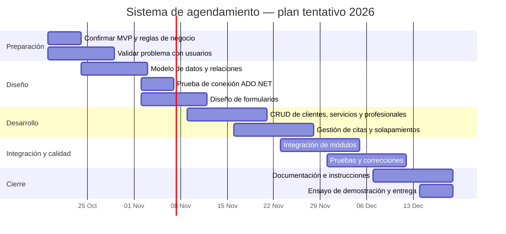

# Diagrama de Gantt — planificación propuesta

**Proyecto:** Sistema de Agendamiento y Gestión para Barberías y Salones de Belleza  
**Equipo:** Virus  
**Estado:** propuesta inicial; las fechas deben confirmarse con el calendario oficial del docente.

El cronograma está organizado para avanzar desde la definición del alcance hasta la preparación de la entrega. Las tareas se superponen cuando pueden realizarse en paralelo. La integración y las pruebas requieren que las funciones correspondientes ya existan.

## Responsables principales

- Alcance, modelo de datos, conexión y backend: Ekaitz Yale Yauli.
- Diseño de formularios y flujo de usuario: Leonor Alejandra Almanza Arroyo.
- Casos de prueba, registro de resultados y documentación: Jairo Damian Rodríguez Huanca.
- Integración, decisiones de alcance y demostración: todo el equipo.

## Dependencias importantes

- El modelo definitivo depende de confirmar el alcance y las reglas de negocio.
- Los formularios conectados dependen de que el modelo y la conexión funcionen.
- Las pruebas de integración dependen de que los módulos estén conectados.
- La documentación final debe describir solo lo que realmente se implementó y probó.

**Importante:** este cronograma es tentativo y no demuestra que las tareas estén completadas. El equipo debe revisar la fecha oficial de entrega y actualizar el plan si las fechas no coinciden.
